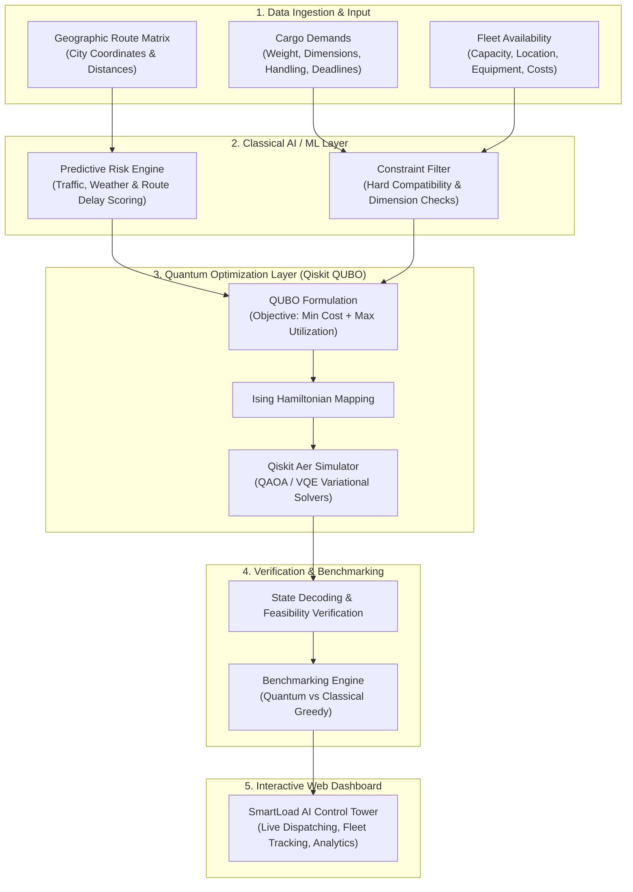

<div align="center">

# 🚚 Q-Logistics (SmartLoad AI)
### Quantum-Enhanced Logistics & Smart Fleet Optimization System

**VTU-QFF-HC-0107** &nbsp;|&nbsp; Tier: **Online** &nbsp;|&nbsp; Track: **Quantum Optimization & Logistics**

</div>

---

<div align="center">

| | |
| :--- | :--- |
| **Team** | OOPs |
| **Team ID** | VTU-QFF-HC-0107 |
| **Tier** | Online |
| **Repository** | [vtu-hc-oops](https://github.com/vtu-qiskit-fall-fest-2026/vtu-hc-oops.git) |
| **Organisation** | [vtu-qiskit-fall-fest-2026](https://github.com/vtu-qiskit-fall-fest-2026) |
| **Event** | VTU-QFF Hackathon — VTU-Qiskit Fall Fest 2026 |

</div>

---

## 📌 Table of Contents

- [Team Members](#-team-members-github-ids)
- [Problem Statement](#-problem-statement)
- [Proposed Solution](#-proposed-solution)
- [Approach & Architecture](#-approach--architecture)
- [Tech Stack](#-tech-stack)
- [Project Structure](#-project-structure)
- [How to Run](#-how-to-run)
- [API Endpoints](#-key-api-endpoints)
- [How to Push Code](#-how-to-push-code)
- [Submission Checklist](#-submission-checklist)
- [Resources](#-resources)
- [License](#-license)

---

## 👥 Team Members (GitHub IDs)

| # | Name | GitHub Username | Role |
| :-- | :--- | :--- | :--- |
| 1 | Yash Gaikwad | [yash-kitcoek](https://github.com/yash-kitcoek) | Team Lead |
| 2 | Prasanna Padatare | [PixiePewds](https://github.com/PixiePewds) | Developer |
| 3 | Tushar Deshmukh | [Tushar-Deshmukh-0019](https://github.com/Tushar-Deshmukh-0019) | Developer |

---

## ❓ Problem Statement

### Context & Real-World Challenge
In modern supply chains, efficiently matching cargo with available delivery trucks and planning optimal routes remains a critical challenge. Mismatches lead to underutilized cargo capacity, higher fuel consumption, increased operational costs, and frequent delivery delays. Because finding the global optimum among thousands of cargo items, fleet sizes, and dynamic constraints is a combinatorial optimization problem, classical search heuristics often settle for suboptimal solutions.

- **Why it matters:** Inefficient logistics allocation causes massive economic waste and excessive carbon emissions annually due to empty-mile transit ("deadheading") and poor capacity utilization. A mathematically rigorous optimization approach avoids local minima and ensures high asset utilization while respecting strict dimensional, timing, and equipment constraints.
- **Track / Category:** Online Track · Track 1 · Quantum Optimization & Logistics

---

## 💡 Proposed Solution

### Executive Summary (Solution in Brief)
Q-Logistics is a hybrid Quantum-AI logistics platform designed to optimize cargo-to-truck matching and dispatch operations. It pairs classical machine learning for delay risk forecasting and vehicle suitability scoring with a Quadratic Unconstrained Binary Optimization (QUBO) model solved via Qiskit. By formulating hard multi-dimensional physical constraints (weight, volume, vehicle equipment) and operational cost matrices into a quantum Hamiltonian, it identifies optimal cargo-fleet assignment configurations. The end result is displayed through an interactive web control tower featuring live dispatch metrics and visual quantum-vs-classical performance benchmarks.

### Key Idea
Formulate multi-constraint cargo-to-fleet assignment as a Quadratic Unconstrained Binary Optimization (QUBO) problem solved with variational algorithms (QAOA / VQE) on Qiskit Aer, seamlessly integrated with predictive AI risk scoring and an interactive logistics control tower dashboard.

### Why this works
Combinatorial logistics matching exhibits exponential complexity where classical greedy algorithms become trapped in local minima. Quantum optimization algorithms leverage superposition and quantum interference to explore the combinatorially vast assignment space, discovering superior global allocation configurations that significantly lower total operational expenditure and transit latency.

---

### Three Interconnected Layers

1. **AI/ML Layer:**  
   Employs predictive machine learning models to forecast delivery delay risks (based on weather, route history, and traffic) and compute load-suitability scores.

2. **Quantum Optimization Layer (100% Software):**  
   Formulates cargo-to-truck matching as a Quadratic Unconstrained Binary Optimization (QUBO) problem. Utilizing Qiskit Optimization (QAOA / VQE algorithms executed via Qiskit Aer simulators), it identifies mathematically optimal assignment matrices on test cases.

3. **Interactive Web Dashboard:**  
   A web-based frontend displaying optimal assignments, predicted delivery timelines, cost breakdowns, and live visual comparisons between classical greedy approaches and quantum-optimized plans.

---

### Real-World Impact & Value

- **Operational Efficiency:** Minimizes empty-mile transport (deadheading), reduces fuel consumption, and optimizes fleet capacity utilization.
- **Proactive Risk Mitigation:** Leverages predictive AI to account for potential delivery delays, traffic bottlenecks, and route anomalies prior to route execution.
- **Demonstrable Quantum Advantage:** Provides clear, visual benchmarking (Cost vs. Computation Speed) on an interactive dashboard to prove the practical utility of hybrid quantum algorithms in logistics.

---

## 🧩 Approach & Architecture



### Detailed Pipeline Stages

1. **Input Data:** Ingests live cargo consignment parameters (origin, destination, weight, dimensions, pickup time, delivery deadline, handling needs) and truck fleet parameters (capacity, dimensions, current city, driver status, operating cost/km, fuel efficiency, equipment).
2. **Preprocessing & AI Layer:** Filters out physically infeasible pairings (e.g. insufficient vehicle clearance, missing required equipment like liftgates or refrigeration). The AI layer calculates ETA, distance metrics, and dynamic delay risks.
3. **Quantum Core:** Formulates matching as a Quadratic Unconstrained Binary Optimization (QUBO) problem where decision variables $x_{ij} \in \{0, 1\}$ signify assigning cargo $i$ to vehicle $j$. Penalty terms enforce one-to-one mapping and vehicle volume/weight capacity constraints, while the objective minimizes cumulative transport cost and deadhead travel. The problem is solved via QAOA and VQE through Qiskit Optimization on Qiskit Aer.
4. **Post-Processing & Benchmarking:** Decodes quantum state vectors into concrete shipment allocations, verifies constraint compliance, and benchmarks quantum allocation scores and operational costs against classical greedy heuristics.
5. **Output & Interactive Control Tower:** Displays the final dispatch assignments, interactive route maps, capacity utilization charts, and live shipment tracking in the web control tower.

---

## 🛠️ Tech Stack

| Layer | Technology |
| :--- | :--- |
| **Frontend & UI** | Vanilla JS (ES6+), Semantic HTML5, CSS3 Glassmorphism System, EJS Templates |
| **Backend & REST APIs** | Node.js (v20+ / v24), Express.js 5 |
| **Quantum SDK** | Qiskit `>=1.0`, Qiskit Aer (`>=0.15`), Qiskit Optimization (`>=0.6`), Qiskit Algorithms |
| **Classical AI & Numerics** | Python 3.11+, NumPy, SciPy, Scikit-learn, Pandas |
| **Simulation & Solvers** | Qiskit `AerSimulator`, QAOA, VQE, Minimum Eigen Optimizer, Classical Heuristic Benchmarks |
| **Data & Persistence** | JSON Document Store (`data/smartload-demo.json`) / MySQL2 compatibility |
| **Testing & Tooling** | Node Test Runner (`node --test`), Pytest, Git + GitHub |

---

## 📁 Project Structure

```text
loadsetu/
├── index.js                  # Express server & REST API endpoints (Cargo, Fleet, Matching, Bookings)
├── package.json              # Node.js dependencies, scripts & configuration
├── requirements.txt          # Python dependencies for Qiskit quantum optimization
├── server.test.js            # Automated backend integration & constraint validation tests
├── views/                    # EJS dynamic UI view templates
│   ├── dashboard.ejs         # SmartLoad AI Logistics Control Tower dashboard
│   ├── index.ejs             # Activity & post feed view
│   └── new.ejs               # Entry creation view
├── public/                   # Client-side static assets
│   ├── app.js                # Frontend application logic, matching engine & dispatch state
│   └── style.css             # Responsive modern design system & UI components
├── data/                     # Operational data & demo scenario storage
│   └── smartload-demo.json   # Seeded cargo consignments, truck fleet, and active bookings
├── README.md                 # Complete project documentation & presentation guide
└── LICENSE                   # MIT License
```

---

## 🚀 How to Run

### Prerequisites

- **Node.js**: v18.0.0 or newer (v24 recommended)
- **Python**: 3.11 or newer (for Qiskit quantum simulations)
- **Git**: Installed and configured

---

### Option 1: Running the Interactive Web Application (Dashboard)

1. **Install Node.js dependencies:**
   ```bash
   npm install
   ```

2. **Start the server:**
   * **Normal mode:**
     ```bash
     npm start
     ```
   * **Development mode (auto-reload on change):**
     ```bash
     npm run dev
     ```

3. **Open in your browser:**
   * Control Tower Dashboard: [http://localhost:8000](http://localhost:8000)
   * API Health Check: [http://localhost:8000/api/health](http://localhost:8000/api/health)
   * System State: [http://localhost:8000/api/state](http://localhost:8000/api/state)

4. **Run backend automated tests:**
   ```bash
   npm test
   ```

---

### Option 2: Running the Python Quantum Optimization Environment

1. **Create and activate a virtual environment:**
   ```bash
   python -m venv .venv
   # On Windows (PowerShell):
   .venv\Scripts\activate
   # On Linux / macOS:
   source .venv/bin/activate
   ```

2. **Install Python quantum dependencies:**
   ```bash
   pip install --upgrade pip
   pip install -r requirements.txt
   ```

3. **Run tests:**
   ```bash
   pytest -q
   ```

---

## 🔌 Key API Endpoints

| Method | Endpoint | Description |
| :--- | :--- | :--- |
| `GET` | `/` | Loads the SmartLoad AI logistics control tower dashboard |
| `GET` | `/api/health` | Returns server health and operational mode status |
| `GET` | `/api/state` | Retrieves all active cargo, trucks, bookings, and supported routes |
| `POST` | `/api/cargo` | Creates and validates a new cargo shipment consignment |
| `PATCH` | `/api/cargo/:id` | Updates an unassigned cargo record |
| `POST` | `/api/cargo/:id/cancel` | Cancels an unassigned cargo consignment |
| `POST` | `/api/trucks` | Registers a new carrier truck with physical specifications |
| `PATCH` | `/api/trucks/:id` | Updates fleet specifications and availability status |
| `GET` | `/api/match/:cargoId` | Computes eligible trucks, cost estimates, ETA, and optimal rank |
| `POST` | `/api/bookings` | Dispatches and locks an optimal truck assignment to cargo |
| `PATCH` | `/api/bookings/:id/status` | Transitions shipment status (`confirmed` → `in_transit` → `delivered`) |

---

## 🔁 How to Push Code

Full walkthrough: **[Git & Collaboration Handbook](../vtu-hc-guide-git-and-collaboration)**.

### Configure Git (first time only)

```bash
git config --global user.name  "Your Name"
git config --global user.email "you@example.com"
```

### Everyday Workflow

```bash
# 1. Get the latest changes from main
git checkout main
git pull origin main

# 2. Create a feature branch
git checkout -b feature/quantum-matching

# 3. Stage and commit your changes
git add .
git commit -m "feat: integrate QUBO formulation for cargo fleet assignment"

# 4. Push the branch to GitHub
git push -u origin feature/quantum-matching

# 5. Open a Pull Request on GitHub and request a review
```

### Commit Message Conventions

| Prefix | Meaning |
| :--- | :--- |
| `feat:` | New feature or algorithmic capability |
| `fix:` | Bug fix in matching, routing, or UI |
| `docs:` | Documentation updates |
| `test:` | Adding or fixing test suites |
| `refactor:` | Code restructuring without behavior changes |
| `chore:` | Build, config, or dependency updates |

---

## ✅ Submission Checklist

- [x] Repository created and **public**
- [x] All team members added as **collaborators** and invitations accepted
- [x] `README.md` updated with complete project details, architecture, problem statement, and solution
- [x] Team members listed under [Team Members](#-team-members-github-ids)
- [x] `requirements.txt` and `package.json` committed and runnable from clean clones
- [x] Automated test suite passing (`npm test` passes 5/5 tests)
- [x] Interactive web dashboard functioning on localhost (`http://localhost:8000`)
- [x] Code pushed to `main` branch
- [ ] Short project summary submitted on the hackathon portal

---

## 📚 Resources

| Resource | Link |
| :--- | :--- |
| 🔁 Git & collaboration handbook | [Git & Collaboration Handbook](../vtu-hc-guide-git-and-collaboration) |
| ❓ Problem statements, solutions & terms | [Problem Statements, Solutions & Terms](../vtu-hc-guide-problem-and-solution) |
| 📄 README writing guide | [README Guide & Template](../vtu-hc-guide-readme-template) |
| ⚛️ Qiskit documentation | https://docs.quantum.ibm.com/ |
| ⚛️ Qiskit Runtime & primitives | https://quantum.cloud.ibm.com/docs/ |
| 🧪 Qiskit Aer simulator | https://docs.quantum.ibm.com/guides/simulator |
| 💻 IBM Quantum Platform | https://quantum.cloud.ibm.com/ |
| 🎓 Qiskit textbook | https://qiskit.qotlabs.org/learning/ |
| 📋 GitHub Docs | https://docs.github.com/ |

---

## 📄 License

Released under the [MIT License](LICENSE). See `LICENSE` for details.

---

<div align="center">

**OOPs** · Team ID `VTU-QFF-HC-0107` · Tier `Online`  
Built with ⚛️ Qiskit & Express for the VTU-QFF Hackathon

[⬆ Back to Top](#-q-logistics-smartload-ai)

</div>
